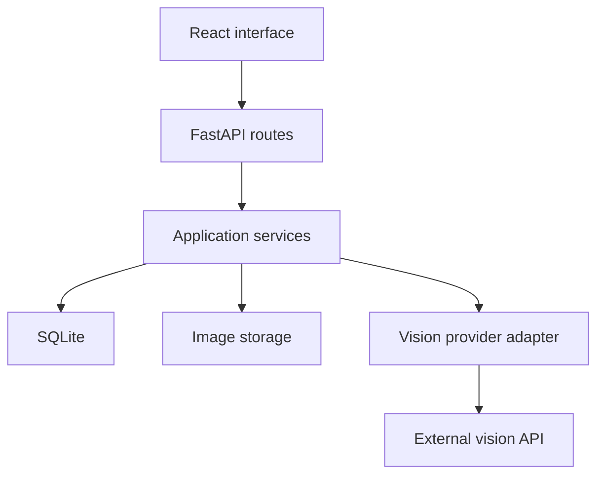

# Phase 1: Design

## Product goal
Help a user recover useful information and actions from saved screenshots. The original image stays available so every proposed field can be checked.

## MVP decisions
- Single-user local application.
- PNG and JPEG input; proposed initial upload limit: 10 MiB, plus a configurable decoded pixel limit.
- Notices/events, bills, and job openings.
- One main extracted item per screenshot, with zero or more suggested actions.
- User review is required before extraction is considered approved.
- Creating a task is a separate explicit approval action.
- Ordinary database search and filters first.
- No automatic external actions.

## Architecture

Routes translate HTTP requests into service calls. Services own upload, extraction, correction, and task rules. The provider adapter isolates vendor-specific requests. Persistence modules handle database access. The API key remains on the backend.

## Upload and extraction
1. Validate byte size, decoded image format, dimensions, and readability. Do not trust the filename or browser MIME type alone.
2. Generate a storage identifier; never use user filenames as storage paths.
3. Save the image and a screenshot record.
4. A separate extraction request calls the vision provider, allowing retry without re-upload.
5. Validate the returned schema, lengths, field types, and category.
6. Save proposed fields and review notes.
7. Display the image with an editable form.
8. User saves corrections, approves the item, and optionally creates tasks.

## Lifecycle
Screenshot processing: uploaded -> extracting -> extracted; extracting -> failed on error. A failed screenshot can be retried.
Item review: needs_review -> approved. Editing an approved item returns it to needs_review.
Task: pending -> completed or cancelled.

Extraction status, review status, and task status describe different things and must be stored separately.

## Uncertainty and evidence
- Missing values remain null.
- Preserve visible date text separately from any normalized date.
- A date without a year or ambiguous date order requires clarification.
- A date-only deadline remains date-only; do not invent midnight.
- Store timezone explicitly for confirmed timed deadlines.
- Distinguish event date, bill due date, and application deadline.
- Keep evidence text for proposed fields when possible. Evidence is model-produced and must be checked against the image.
- Schema validation does not prove factual correctness.
- Instructions embedded in screenshots are untrusted content, never authority to run tools or change system behavior.
- Visible URLs are suggestions to review; the backend does not automatically fetch or execute them.

## Failure behavior
Unreadable images are rejected. Provider timeouts and malformed output produce a clear retryable error and retain the original upload. Cap provider retries and request duration.
Re-extraction must not silently overwrite user-reviewed information. Initial design: reject extraction when an item already exists; a future explicit reset can support replacement.
Avoid logging image contents, credentials, or extracted personal information.

## Privacy
Vision extraction sends the image to the selected external provider. Explain this before enabling extraction; choose a provider after checking its current data handling and cost. Development screenshots must be synthetic or redacted.
Deleting a screenshot removes its image, extracted item, and associated tasks. Report cleanup failures so they can be retried.

## Deferred choices
Exact dependency versions, model provider, pixel limit, timeout, deployment host, and notification mechanism will be selected during their implementation milestones.
